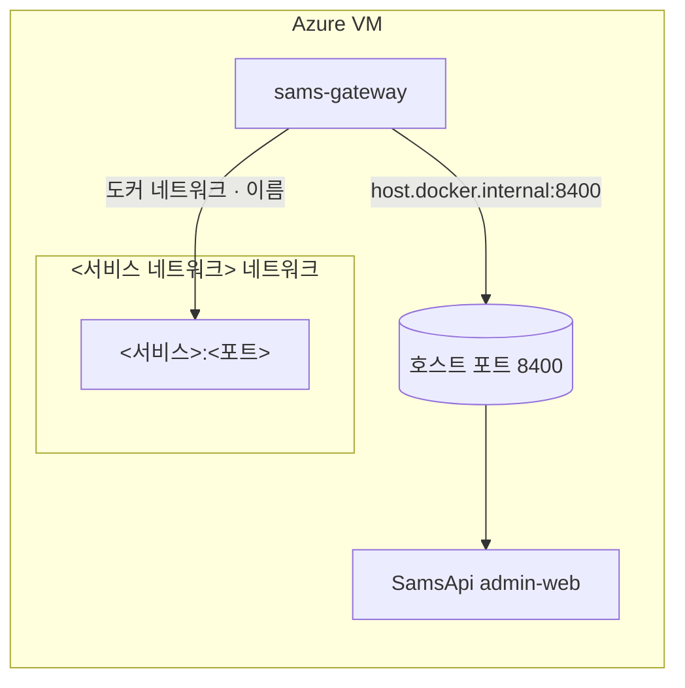
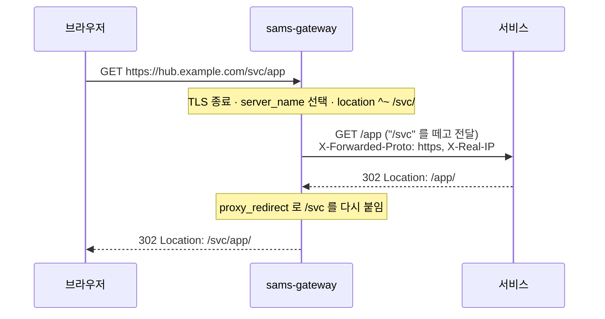

# 구성 개요

게이트웨이는 컨테이너 하나(`sams-gateway`)와 설정 파일 몇 개로 이루어집니다. 이 페이지는 무엇이 어디에 붙어 있고, 요청이 어떤 길로 서비스까지 가는지 설명합니다.

## 저장소 구성

| 파일 | 내용 |
|---|---|
| `docker-compose.yml` | 게이트웨이 컨테이너 정의 (포트, 볼륨, 네트워크, `extra_hosts`) |
| `conf.d/<대표 도메인>.conf` | 대표 도메인: 80 처리, 443 기본 서버, 경로별 사이트 |
| `conf.d/samsapi.conf` | SamsApi 전용 도메인 서버 블록 |
| `deploy.sh` | 설정 배포 (검사 → 반영 → reload) |
| `cert.sh` | 인증서 발급·이름 추가·갱신 cron 등록 |
| `README.md` | 사이트 목록과 운영 요약 |

인증서 파일은 저장소에 넣지 않습니다. VM 의 certbot 폴더(`~/certbot/conf`, `~/certbot/www`)에 있고 컨테이너에는 읽기 전용으로 붙습니다.

## 컨테이너

| 항목 | 값 | 이유 |
|---|---|---|
| 이미지 | `nginx:1.27-alpine` | upstream `resolve`(서비스 재생성 추종)는 1.27.3 이상 필요 |
| 포트 | `80:80`, `443:443` | VM 에서 외부로 열린 웹 포트는 이 둘뿐 |
| 볼륨 | `./conf.d` → `/etc/nginx/conf.d` (ro) | 설정은 저장소가 원본 |
| 볼륨 | `~/certbot/conf` → `/etc/letsencrypt` (ro) | 인증서 |
| 볼륨 | `~/certbot/www` → `/var/www/certbot` (ro) | Let's Encrypt 검증 파일 |
| `extra_hosts` | `host.docker.internal:host-gateway` | 호스트 포트로 열린 서비스를 찾아가는 이름 |
| 네트워크 | `<서비스 네트워크>` (external) | 도커 네트워크로 붙는 서비스를 이름으로 찾기 위함 |
| 재시작 | `unless-stopped` | VM 재부팅 시 자동 기동 |

## 서비스로 가는 두 가지 길

| | 호스트 포트 (`host.docker.internal`) | 도커 네트워크 (external) |
|---|---|---|
| 예 | SamsApi (8400) | 인증서 관리 서비스 |
| 서로의 독립성 | 높음. 서비스를 내려도 게이트웨이는 뜬다 | 서비스가 `docker compose down` 하면 네트워크가 지워져 게이트웨이 재연결 필요 |
| 서비스 컨테이너가 바뀔 때 | 호스트 포트가 같으면 영향 없음 | upstream `resolve` 로 5초 안에 새 IP 추종 |
| 서비스 쪽 조건 | 호스트에 포트를 열되 VM 방화벽(NSG)은 닫아 둠 | 외부 포트 불필요 |

새 사이트는 호스트 포트 방식을 권장합니다. 자세한 기준은 [설계 결정 기록](decisions.md)에 있습니다.

## 요청 흐름

1. **TLS 종료**: 게이트웨이가 인증서로 HTTPS 를 끝냅니다. HTTP/2 를 켜 둡니다.
2. **서버 선택**: `Host` 로 서버 블록을 고릅니다. 모르는 이름은 대표 도메인 블록(`default_server`)으로 가서 404 를 받습니다.
3. **경로 선택**: 대표 도메인에서는 경로 접두사로 사이트를 고르고, 접두사를 떼어 서비스에 넘깁니다.
4. **응답 보정**: 서비스가 돌려주는 이동 주소(`Location`)에 접두사를 다시 붙입니다.

규칙의 세부는 [라우팅 규칙](routing.md)을 보세요.

## 뒤 서비스에 넘기는 정보

| 헤더 | 값 | 용도 |
|---|---|---|
| `Host` | 원래 요청의 호스트 | 서비스가 절대 주소를 만들 때 |
| `X-Real-IP`, `X-Forwarded-For` | 실제 접속자 IP | 접속 로그, IP 제한 |
| `X-Forwarded-Proto` | `https` | 서비스가 https 로 이동 주소를 만들도록 |
| `Connection` | 빈 값 | upstream keepalive 재사용 |

!!! note "서비스 쪽이 TLS 를 하는 경우"
    인증서 관리 서비스는 자체 nginx 가 TLS 를 하고 있어, 게이트웨이 → 서비스 구간도 `https://` 로 넘깁니다. 같은 인증서를 공유하므로 갱신 때 두 컨테이너를 함께 reload 합니다 ([인증서](certificates.md)).

## 보안 관련 응답

| 대상 | 설정 |
|---|---|
| 대표 도메인 | HSTS 1년(`max-age=31536000`), `X-Robots-Tag: noindex, nofollow`, `/robots.txt` 전체 차단 |
| 대표 도메인 루트·미등록 경로 | `404` |
| SamsApi 도메인 | HSTS 없음 (평문 8400 을 쓰는 사용자가 남아 있는 동안) |
| 80 포트 | Let's Encrypt 검증 경로만 응답, 나머지는 같은 주소의 https 로 301 |
