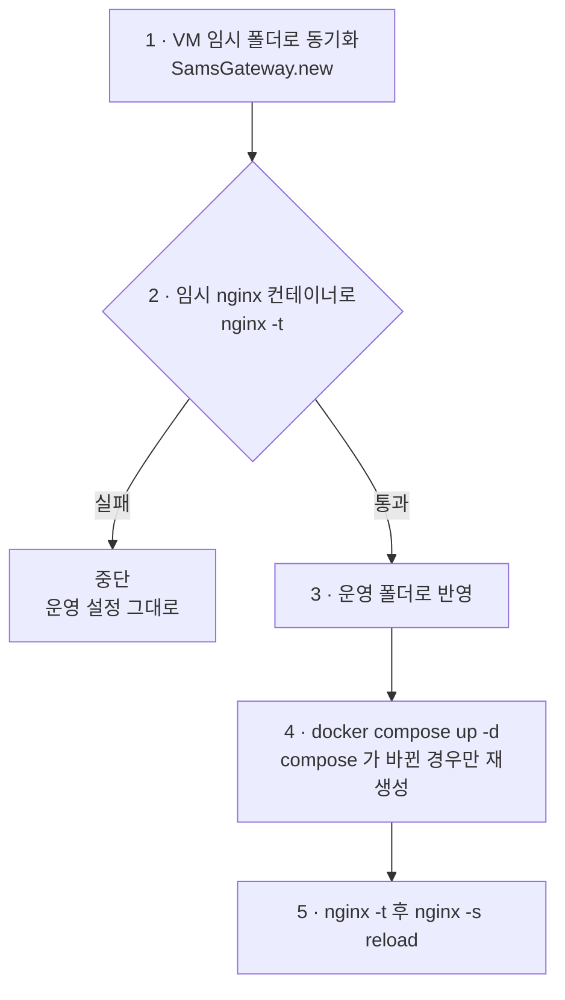

# 배포

게이트웨이 설정은 개발 PC 에서 `./deploy.sh` 한 번으로 VM 에 반영합니다. 새 설정을 임시 컨테이너에서 먼저 검사하고, 통과했을 때만 운영 폴더에 반영한 뒤 nginx 를 무중단 reload 합니다. CI 는 쓰지 않습니다.

## 흐름



| 단계 | 하는 일 | 서비스 영향 |
|---|---|---|
| 1 | `rsync` 로 저장소를 VM 의 `~/project/SamsGateway.new/` 에 복사 (`.git`, `.env` 제외) | 없음 |
| 2 | 운영과 같은 조건(도커 네트워크, `host.docker.internal`, 인증서 마운트)의 임시 컨테이너에서 `nginx -t` | 없음 |
| 3 | 임시 폴더를 운영 폴더 `~/project/SamsGateway/` 로 덮어쓰고 임시 폴더 삭제 | 없음 |
| 4 | `docker compose up -d` — compose 파일이 바뀌었을 때만 컨테이너 재생성 | 재생성 시 1~2초 |
| 5 | 운영 컨테이너에서 다시 `nginx -t` 후 `nginx -s reload` | 없음 (graceful) |

## 왜 임시 컨테이너로 검사하나

nginx 는 설정에 오류가 있으면 reload 를 거부하고 기존 설정으로 계속 돕니다. 그런데 **컨테이너가 재생성되는 경우**(4단계)에는 잘못된 설정으로 시작하지 못해 정문 전체가 멈춥니다. 그래서 반영 전에 운영과 같은 조건으로 검사합니다.

검사 컨테이너는 운영과 같은 것을 갖춰야 합니다.

- 같은 도커 네트워크 (`--network <서비스 네트워크>`) — upstream 이름 해석
- 같은 `--add-host host.docker.internal:host-gateway`
- 같은 인증서·검증 폴더 마운트 — `ssl_certificate` 파일 존재 검사

하나라도 빠지면 운영에서는 문제없는 설정이 검사에서 실패합니다. 이 경우에도 운영은 안전하게 그대로 남습니다. 게이트웨이 compose 에 새 네트워크나 `extra_hosts` 를 추가하면 `deploy.sh` 의 검사 명령에도 같이 추가해야 합니다.

## 무중단 정도

| 변경 | 끊김 |
|---|---|
| `conf.d/` 만 변경 | 없음 (reload 는 기존 연결을 끝까지 처리) |
| `docker-compose.yml` 변경 (포트·볼륨·네트워크) | 컨테이너 재생성으로 1~2초, 모든 사이트 |
| 서비스 쪽 재배포 | 게이트웨이와 무관. 도커 네트워크 방식은 upstream `resolve` 가 5초 안에 새 IP 를 따라감 |

## 실행 조건

- 개발 PC 에서 VM 으로 SSH 키 접속이 되어야 합니다. 대상은 환경변수 `VM` 으로 바꿀 수 있습니다.

```bash
VM=<계정>@<VM 주소> ./deploy.sh
```

- VM 에 `nginx:1.27-alpine` 이미지가 있어야 합니다(없으면 처음 한 번 내려받음).

## 되돌리기

설정 원본은 저장소입니다. 문제가 생기면 커밋을 되돌린 뒤 다시 배포합니다.

```bash
git revert <커밋>
./deploy.sh
```

VM 에서 직접 파일을 고치지 마세요. 다음 `deploy.sh` 가 저장소 내용으로 덮어씁니다.
