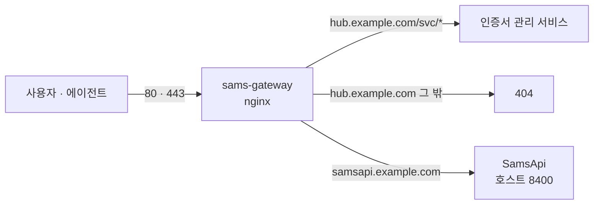

# SamsGateway 개발 문서

SamsGateway 는 Azure VM 앞에 선 **정문 nginx** 입니다. 외부 80·443 을 받아 HTTPS 를 처리하고, **도메인 이름**과 **경로**를 보고 같은 VM 의 각 서비스로 요청을 넘깁니다.

## 한눈에 보기

| 이름 | 역할 |
|---|---|
| `hub.example.com` (대표 도메인) | 사내 사이트 모음. 사이트를 **경로**로 구분하고, 루트와 미등록 경로는 404 |
| `samsapi.example.com` | SamsApi 전용 도메인. 다른 사이트를 붙이지 않음 |
| 컨테이너 `sams-gateway` | nginx 1.27 (alpine), 80·443 공개, 설정은 `conf.d/` |
| `deploy.sh` | 설정 검사 후 무중단 반영 |
| `cert.sh` | Let's Encrypt 인증서 발급·이름 추가·자동 갱신 등록 |

## 원칙

- **서비스는 외부 포트를 열지 않는다.** 외부에서 들어오는 길은 게이트웨이 하나다.
- **게이트웨이는 서비스에 최대한 묶이지 않는다.** 호스트 포트로 열린 서비스는 `host.docker.internal` 로 찾아가고, 도커 네트워크 연결은 꼭 필요할 때만 쓴다.
- **아무것도 알려 주지 않는다.** 대표 도메인의 루트와 미등록 경로는 404, 검색엔진 색인도 막는다.
- **검사하지 않은 설정은 반영하지 않는다.** 배포는 항상 `deploy.sh` 로, 임시 컨테이너에서 검사한 뒤 reload 한다.

## 어디서부터 읽을까

- 처음이라면 [구성 개요](architecture.md) → [라우팅 규칙](routing.md).
- 새 사이트를 붙이려면 [새 사이트 추가](add-site.md).
- 설정을 바꾸고 반영하려면 [배포](deployment.md), 인증서는 [인증서](certificates.md).
- 접속이 안 될 때는 [운영 · 트러블슈팅](operations.md).
- 왜 이렇게 만들었는지는 [설계 결정 기록](decisions.md).

관련 문서: [SamsApi 개발 문서](https://sinokorofficial.github.io/samsapi-docs/)

!!! note "공개 문서"
    이 사이트는 공개 저장소에서 발행됩니다. 실제 도메인은 `hub.example.com`, `samsapi.example.com` 으로, 서버 주소·계정은 `<VM 주소>` 같은 자리표시자로 표기합니다.
